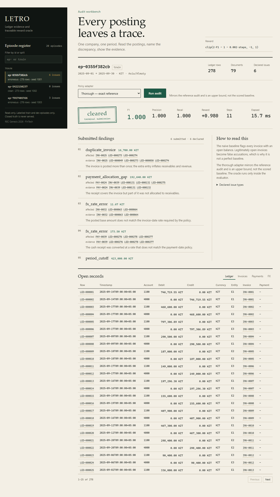

# LETRO

**Ledger Evidence & Traceable Reward Oracle** — a reproducible reinforcement-learning
environment for training and evaluating a financial-audit agent.

One episode is one fictional company and one reporting period. The agent receives
read-only ledger, invoice, payment and FX records, investigates them with a narrow
tool interface, and submits findings. A closed evaluator matches those findings
against a hidden answer that was derived from the same open records, so every
reported discrepancy is provable and no unavailable fact is required.

The project is built for the REC Genesis Hackathon (FinTech track). It is a software
artefact, not a professional audit opinion. All companies, people, accounts and
amounts are synthetic.

## Quick start

Requirements: Python 3.11 or newer, no third-party packages.

```console
python --version
python -m letro.verify
```

`python -m letro.verify` is the single verification command. It runs the contract,
data, reward and reproducibility suites, checks the engineering artefacts, prints a
per-criterion table and exits non-zero on any failure. The expected final line is
`RESULT: PASS` with `TOTAL 100.00`.

Run the unit tests separately:

```console
python -m unittest discover -s tests -v
```

Check the official judge adapter imports from the repository root:

```console
python -c "import judge_adapter; print(judge_adapter.__all__)"
```

## Python API

The environment has two construction styles. The lazy style is the one a jury
harness usually expects:

```python
from letro.env import AuditEnv, LetroEnv
from letro.presets import preset

env = AuditEnv()                       # or LetroEnv(mode="eval")
observation, info = env.reset(seed=4242, config=preset("clean"))
observation, reward, terminated, truncated, info = env.step(
    {"type": "list_records", "table": "ledger", "limit": 10}
)
```

`reset` returns `(observation, info)`; `step` returns
`(observation, reward, terminated, truncated, info)`. A step before `reset` starts
the episode. `LetroEnv(mode="eval")` hides the terminal reward and diagnostics from
the policy while the evaluator keeps them. The environment never receives truth or
the seed: it holds only open data and a `finalize` closure owned by the runner.

## Jury harness, fuzz and workbench

```console
python -m letro.jury
python -m letro.fuzz --quick
python -m letro.fuzz --seeds 100
python -m letro.ui
```

`letro.jury` runs 20 unseen seeds with the four required adapters, 20 ID/order
permutations and 5 exact replays, checks observation isolation and exits non-zero on
failure. `letro.fuzz` checks 5 presets (default, hard, hard_composite, clean, wide)
for balance, truth reproduction, evidence resolution and permutation stability;
`--seeds 100` covers 500 episodes. `letro.ui` serves a read-only workbench at
http://127.0.0.1:8000 for the labelled train/dev episodes. The workbench is a demo
surface, not part of the scored environment; it never serves `truth.json`.

## Proof pack

The proof pack independently shows that truth is derived from open data, that reward
cannot be gamed, and that truth cannot leak through the observable surface:

```console
python -m letro.redteam
python -m letro.proof
python -m letro.isolation
python -m letro.bench
python -m letro.difficulty
python -m letro.challenge --episode ep-... --findings submission.json
```

`letro.redteam` runs 12 adversarial submissions (mark-all, duplicate spam,
evidence-less, wrong currency, wrong amount, guessed IDs, empty on clean, empty on
error, timeout, oversized payload, resubmit, duplicate correct) and asserts each stays
below its published bound; every attack must fail to earn reward. `letro.proof`
generates a clean episode and a single-error episode for each of the four error types
and both composites, and asserts the audit difference is exactly one issue (two for a
composite) with inclusion-minimal, independently recomputed evidence. `letro.isolation`
plants a canary string in a copied truth/provenance object, runs every action through
an eval-mode environment, and asserts the canary never appears in observations, info,
errors or trajectory records; a static AST check forbids `env.py` and `tools.py` from
importing the evaluator, the audit or the factory. `letro.bench` measures generation,
reset and 100 steps against the 60-second budget, peak memory against 4 GB, and the
`git archive` artefact against 1 GB, and checks hash-seed digest stability. `letro.difficulty`
measures per-error-type precision/recall for random, naive reconciliation, thorough,
limited-budget and mark-all policies, and counts clean-episode distractors (split
payments, refunds, recurring identical amounts, legitimately open invoices) that still
audit to zero. `letro.challenge` scores a submission file and prints only aggregates
— TP/FP/FN, precision/recall/F1 and reward — with no truth ids, amounts or evidence
sets.



## Container

```console
docker build -t letro:1.0.0 .
docker run --rm letro:1.0.0
docker run --rm -p 8000:8000 letro:1.0.0 python -m letro.ui --host 0.0.0.0
```

The image uses `python:3.11-slim`, installs no packages, runs as an unprivileged
user and executes `python -m letro.verify` by default. The repository contains no
runtime dependencies and the verifier makes no network calls; `requirements.txt`
documents that explicitly.

## Reproduce the shipped artefacts

```console
python scripts/build_episodes.py
python scripts/record_trajectories.py
python scripts/evaluate_policies.py
python scripts/demo.py
```

`build_episodes.py` is deterministic and rewrites `episodes/train`, `episodes/dev`
and `episodes/index.json`. The index records every seed, resolved config, issue
type, row/document count and the SHA-256 of the open files. `record_trajectories.py`
writes `trajectories/trajectories.jsonl` and `summary.json`; `evaluate_policies.py`
writes `docs/evidence/policy-metrics.json`; `demo.py` prints a scripted
thorough run on a composite episode and an empty submission on clean books.

## Episode data contract

Each directory contains six open files and two closed files:

| File | Visibility | Content |
| --- | --- | --- |
| `manifest.json` | open | schema version, episode id, base currency, period bounds, timezone, row/document counts, rounding and FX policy |
| `ledger.csv` | open | `row_id, timestamp, account, debit_minor, credit_minor, currency, entity_id, invoice_id, payment_id` |
| `invoices.jsonl` | open | `doc_id, invoice_id, entity_id, customer, issued_at, due_at, currency, total_minor, line_items` |
| `payments.jsonl` | open | `doc_id, payment_id, timestamp, currency, amount_minor, invoice_refs` |
| `fx.csv` | open | `date, source_currency, target_currency, rate` |
| `policy.json` | open | period bounds, rounding, rate-date choices, tolerance, evidence rule |
| `truth.json` | closed | issue id, type, canonical affected ids, expected amount in base minor units, currency, allowed evidence sets, explanation |
| `provenance.json` | closed | generation steps and seed fingerprint |

Rules: timestamps are ISO-8601 with an explicit offset; money is integer minor
units; FX rates are decimal strings; missing links are explicit `null` in JSON and
an empty field in CSV. Ledger rows are double-entry in the base currency and every
journal entry balances. Invoice and payment documents keep their original currency.
Limits: 200–2000 ledger rows, 20–200 documents, 0–12 truth issues, 30 findings,
10 evidence ids, 1000 explanation characters.

The generator first builds clean books and then injects errors. Truth is not written
by hand: after injection an independent reference audit reads only the open files
and reconstructs every discrepancy. Generation fails if the audit count differs from
the configured count, which makes contradictory or unsolvable episodes impossible
to ship silently.

## Actions

The policy calls the canonical envelope `{"name":"<action>","args":{...}}`; the
adapter translates it to the internal `{"type":...}` form. Required names:

| Action | Arguments | Result |
| --- | --- | --- |
| `list_records` | `table`, `cursor` (null on first page), `limit` | `{"records":[...],"next_cursor":null|string}`; `limit` 1–50, stable cursor |
| `get_record` | `table`, `id` | one ledger row or document by business id or `doc_id` |
| `get_document` | `doc_id` | one invoice or payment document via the documented interface |
| `calculator` | `expression` | safe decimal arithmetic (`+ - * /` and parentheses), result as a decimal string |
| `submit` | `findings` | terminates the episode; valid structure returns `{"accepted":true}`, otherwise a bounded structural error |

An invalid action or unknown id returns a short error, consumes one step and does
not reveal hidden data. There is no shell, SQL, filesystem or network access. The
episode limit is 100 steps including `submit`; reaching the limit terminates with
`truncated=True` and an empty answer. `submit` counts toward the 100-step budget
but not toward `inspection_steps`; every other action including errors counts
toward `inspection_steps`.

## Findings and matching

`submit` receives:

```json
{
  "episode_id": "ep-...",
  "findings": [
    {
      "type": "duplicate_invoice",
      "affected_ids": ["INV-0001", "LED-000273", "LED-000274"],
      "claimed_amount_minor": 1670000,
      "currency": "KZT",
      "evidence_ids": ["INV-0001", "LED-000273", "LED-000274"],
      "explanation": "The invoice is posted twice."
    }
  ]
}
```

The four types are `duplicate_invoice`, `payment_allocation_gap`, `fx_rate_error`
and `period_cutoff`. Official matching conventions (strict mode, used by the
judge adapter):

- the same type — exact string, no synonyms or normalization;
- the exact canonical `affected_ids` set — exact IDs, case and whitespace
  significant, treated as a set (order and repeats do not matter);
- the same currency — exact code as in `manifest`/`policy`/`truth`; no case
  change, no trimming, no auto-conversion;
- the claimed amount — a JSON integer (not bool/string/float) in minor units;
  expected vs claimed within the documented tolerance `τ` per type (default
  `τ = 0`, inclusive `abs(claimed - expected) <= τ`);
- at least one complete allowed evidence set — every evidence id must exist in
  the open data (ledger `row_id`, invoice `doc_id`/`invoice_id`, payment
  `doc_id`/`payment_id`); a superset of an allowed set is accepted; a
  nonexistent id makes the finding an FP, it never reveals unavailable data.

Unmatched findings and repeated findings are false positives; missed issues are
false negatives. Explanations are never scored, so persuasive text cannot change
the result. Malformed structure (wrong value type, missing required field, more
than 30 findings, more than 10 evidence ids in one finding, explanation over
1000 characters) terminates the episode with reward `-1`.

Matching uses a maximum-cardinality bipartite graph (every submitted finding is
a separate vertex, repeats stay separate vertices); ties break by truth
`issue_id` lexicographic order, then the lexicographically smallest sorted
sequence of `(issue_id, finding index)` pairs. `P = TP/(TP+FP)`,
`R = TP/(TP+FN)`, `F1 = 2TP/(2TP+FP+FN)`. A zero denominator gives 0. Empty
truth with empty findings gives F1 = 1; empty truth with any finding gives F1 = 0.

Limits checked first on raw structure, then on normalized sets: 31 findings, 11
evidence ids in one finding, or an explanation over 1000 characters make the
whole submission invalid with reward `-1`.

## Reward

The terminal reward is exactly:

```text
clip(2 * F1 - 1 - 0.002 * inspection_steps, -1, 1)
```

`inspection_steps` counts every action except `submit`, including invalid actions.
There is no shaping reward during investigation. In training mode the terminal
reward is returned to the policy. In evaluation mode the environment returns
`reward = 0.0` and no diagnostics; the evaluator keeps the real reward and metrics
until the run ends. The environment object never receives truth: it holds only open
data and a `finalize` callback owned by the runner.

Numeric results (TP/FP/FN, money, steps) are exact integers; reported real values
are compared with absolute tolerance `1e-9` (no relative tolerance) and are not
rounded to 6 decimals in the official exact mode; the clip range is `[-1, 1]`.

## Official judge adapter

`judge_adapter.py` at the repository root is the thin adapter the Genesis FinTech
jury uses. It wraps the existing LETRO generator and environment — it does not
create a new task or choose actions for a policy.

```python
from judge_adapter import make_env, generate_episode, score_episode

env = make_env()
observation, info = env.reset(
    seed=4242,
    config={"mode": "train", "team_config": {}},
)
observation, reward, terminated, truncated, info = env.step(
    {"name": "list_records", "args": {"table": "ledger", "limit": 50}}
)
```

Entry points (exact signatures):

| Entry point | Signature | Purpose |
| --- | --- | --- |
| `generate_episode` | `(seed: int, config: dict, output_dir: str) -> None` | Write one complete episode: open files plus closed `truth.json` and `provenance.json`. Wrapper over `letro.generator.generate_episode` plus `write_episode(include_closed=True)`. |
| `make_env` | `() -> JudgeEnv` | Construct the canonical environment exposed to a jury policy. |
| `score_episode` | `(episode_dir: str, findings: dict, inspection_steps: int) -> dict` | Judge-side scoring: strict validation, strict matcher with available evidence, exact (unrounded) reward. Returns `{"tp","fp","fn","precision","recall","f1","return"}`; invalid submission returns `return=-1` with all metrics null. |

`JudgeEnv.reset(seed, config)` supports two modes:

- `mode="train"`: generates a fresh episode from `seed`/`team_config`; used for training and for closed-mode `team_config` expansion.
- `mode="closed"`: requires `config={"mode":"closed","episode_dir":"<dir>","team_config":{...}}`; loads exactly that episode via `letro.generator.load_episode` and never regenerates or renames IDs. Repeated `reset` restarts the same episode.

`JudgeEnv.step(action)` takes the canonical envelope `{"name":"<action>","args":{...}}` with names `list_records`, `get_record`, `get_document`, `calculator`, `submit`, and returns `{"result":...,"error":...,"remaining_steps":...}` later observations; the first observation is `{"task","manifest","policy","remaining_steps"}`. In closed mode `reward` is `0` and no metrics or truth reach the policy. A wall-clock deadline of 60 seconds from `reset` returns `truncated=True` with an empty answer and error code `time_limit`.

## Baselines

All adapters were measured on the same ten dev episodes (five clean, five with
errors, including composites). Full data: `docs/evidence/policy-metrics.json`.

| Policy | Mean F1 | Clean F1 | Erroneous F1 | Mean reward | Mean steps | TP | FP | FN |
| --- | ---: | ---: | ---: | ---: | ---: | ---: | ---: | ---: |
| `random_explorer` | 0.400 | 0.800 | 0.000 | -0.211 | 15.0 | 0 | 12 | 24 |
| `reconciliation` | 0.146 | 0.000 | 0.293 | -0.717 | 11.8 | 15 | 143 | 9 |
| `thorough` (reference) | 1.000 | 1.000 | 1.000 | 0.978 | 11.8 | 24 | 0 | 0 |
| `mark_all` | 0.000 | 0.000 | 0.000 | -1.000 | 2.0 | 0 | 300 | 24 |
| `oracle` (evaluator side) | 1.000 | 1.000 | 1.000 | 1.000 | 1.0 | 24 | 0 | 0 |

The `reconciliation` adapter is an honest, simple heuristic: it finds duplicate
postings, FX mismatches and cut-offs, but it reports every invoice with an open
balance as an unallocated payment. Legitimately open invoices therefore become
false positives (clean F1 0.000) and a gap behind a part-paid invoice gets the
wrong amount. Its low score is the measured evidence that the task is not solved
by a naive rule.

The `thorough` adapter is the exact reference arithmetic used as an upper bound
and in the demo. It proves the environment is solvable and the matcher is
correct; it is not evidence that a language model can perform the same audit.
The oracle reads closed truth and exists only to test the evaluator.

## Trajectories

`trajectories/trajectories.jsonl` contains 500 records from 40 runs over all 20
episodes. Every record has exactly seven fields: `episode_id`, `step`, `action`,
`observation`, `reward`, `terminated`, `truncated`. Observations are scanned for
forbidden keys before writing; `truth.json`, `provenance.json`, issue ids, expected
amounts, affected-id sets and answer keys never appear. The oracle is not recorded
because its answers come from closed truth.

## Reproducibility and generalization

The same seed and config reproduce byte-identical open files and identical rewards.
The verifier replays episodes and also applies a harmless transformation: every
invoice, payment, ledger row and document id is renamed, all tables are shuffled,
and truth is rebuilt from the transformed open files. The oracle answer and reward
must be preserved, which they are for all 20 paired checks.

## Generator config keys for the official checklist

The generator accepts documented keys so the jury can reproduce every required
scenario deterministically (defaults preserve current behavior):

| Key | Values | Default | Purpose |
| --- | --- | --- | --- |
| `gap_mode` | `partial` \| `missing` \| `mixed` | `partial` | How a payment allocation gap is injected. `missing` removes the whole AR credit and posts the full amount to suspense (full missing allocation); `partial` reduces AR credit by 40%; `mixed` chooses randomly. |
| `composite_scenario` | `alternate` \| `first` \| `second` \| `both` | `alternate` | Which documented interaction scenario is used for `composite` episodes. `second` alone is independently selectable. |
| `split_payment` | boolean | `true` | Allow split payments (D02-style). |
| `refund` | boolean | `true` | Allow refunds (D03-style). |
| `recurring` | boolean | `true` | Allow recurring expenses (D05-style legitimately repeating amounts). |
| `force_split_payment` | boolean | `false` | Guarantee at least one split payment in clean books (D02). |
| `force_refund` | boolean | `false` | Guarantee at least one refund in clean books (D03). |

Unknown top-level config keys are rejected at validation time.

## Official Genesis FinTech checklist mapping

| Checklist block | Points | What it tests | LETRO status |
| --- | --- | --- | --- |
| Block 1 — Contract tests (C01–C20) | 25 | Reset, first/later observation, manifest, paged `list_records`, `get_record`/`get_document`, `calculator` restriction, bounded errors, `submit` semantics, 100-step budget, 60 s wall clock, closed-mode reward isolation | Implemented via `judge_adapter.py`; full verifier 100/100 plus 12 adapter tests. |
| Block 2 — Closed episodes (D01–D20) | 25 | Clean, split payment, refund, repeating amounts, currency/period boundary, duplicate invoices, missing/partial allocation, FX/date errors, period errors, two documented interaction scenarios | Generator knobs (`gap_mode`, `composite_scenario`, `split_payment`, `refund`, `recurring`) make every scenario independently selectable. |
| Block 3 — Matcher/reward (20 unit tests + M01–M12) | 25 | Exact IDs/currency/amount/evidence, `τ` default 0, max-cardinality matching with deterministic tie-break, structural limits (30/10/1000), `1e-9` numeric tolerance, clip `[-1,1]`, unknown type → FP not crash | Strict matcher/validator/reward path; 32 official/example tests all pass. |
| Block 4 — Pair checks (P01–P20) | 15 | Record reorder + bijective ID replacement on both sides; oracle correctness after inverse ID mapping; reproduction from same seed/config | `load_episode` loads transformed `episode_dir`; truth/provenance rebuilt in the closed evaluator process; all 20 paired checks pass. |
| Engineering anchors (5 × 0/1/2) | 10 | One launch command, versioned config/dependencies, `trajectories.jsonl` with §09 fields, measured failure analysis, honest limitations | Documented one command (`python -m letro.verify`), CI workflow, 500-record trajectories, `docs/FAILURE-ANALYSIS.md` with measured bugs and fixes, Limitations section. |

Total official checklist score: 100 points. Project self-verifier (`python -m
letro.verify`) is a separate, self-defined rubric (also 100/100) and does not
replace the official jury checks.

## Continuous integration and runbook

`.github/workflows/ci.yml` runs the tests, the verifier, the jury harness and the
quick fuzz on Python 3.11, then builds and runs the container. `docs/RUNBOOK.md`
covers start/stop, common failures, the container and the hidden-seed check.

## Layout

```text
letro/                 environment, tools, matcher, reward, evaluator, verifier
letro/generator/       clean company builder, error injection, reference audit
letro/policies/        four baseline adapters plus the thorough reference
letro/ui/              read-only local workbench (stdlib http.server)
letro/jury.py          hidden-style integration harness
letro/fuzz.py          500-episode invariant and permutation sweep
letro/presets.py       default, hard, hard_composite, clean, wide
letro/redteam.py       12 adversarial submissions with published reward bounds
letro/proof.py         causal truth and evidence minimality proof
letro/isolation.py     canary sentinel and static boundary check
letro/bench.py         compute envelope, memory and archive-size measurement
letro/difficulty.py    per-error-type precision/recall and distractor counts
letro/challenge.py     sanitized submission scorer (aggregates only, no truth)
scripts/               episode build, trajectory recording, policy metrics, demo
episodes/train|dev/    10 + 10 open episodes with closed labels
trajectories/          recorded runs and summary
tests/                 190 unit and integration tests
docs/                  design, failure analysis, readiness, runbook, evidence
```

## Limitations

- The data is synthetic and deliberately small. The four-type taxonomy and the
  ±1 minor-unit tolerance are competition conventions, not a model of materiality
  or of a real audit.
- The simple reconciliation baseline is intentionally imperfect: it finds the
  provable duplicate, FX and cut-off issues but over-reports open invoices, so it
  scores 0.146 on dev. The `thorough` reference reaches 1.000 and proves the
  environment is solvable; neither number says anything about an LLM.
- Hidden grading seeds come from the same generator family as the open episodes.
  Generalization is therefore measured within one distribution; out-of-family
  documents, currencies or accounting standards are not covered.
- No model is trained and no GPU is used. The reward measures the quality of a
  submitted answer and its evidence, not the quality of an audit opinion.
- The environment exposes a narrow read-only interface by design. It cannot test
  tool misuse that requires filesystem, shell or network access, because those
  capabilities do not exist here.
- The workbench is a demo surface. It is read-only, serves only labelled train/dev
  episodes, and earns no competition points; it is not a hosted product.
- The 500-episode fuzz covers one generator family and five presets. It is strong
  evidence against contract drift, not proof of real-world generality.

## License

MIT. See `LICENSE`.

